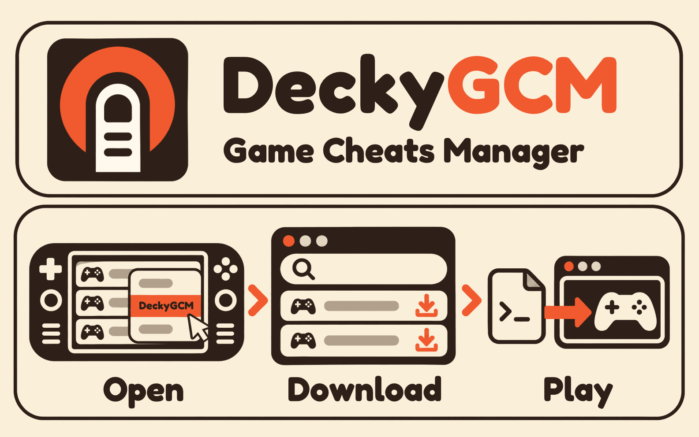
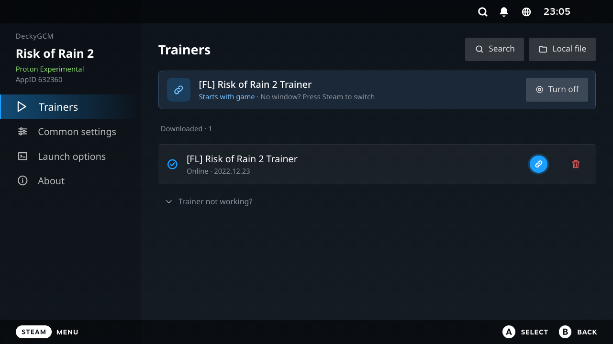
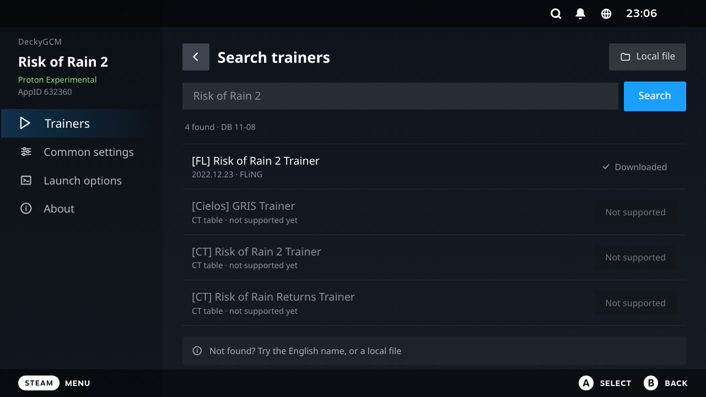
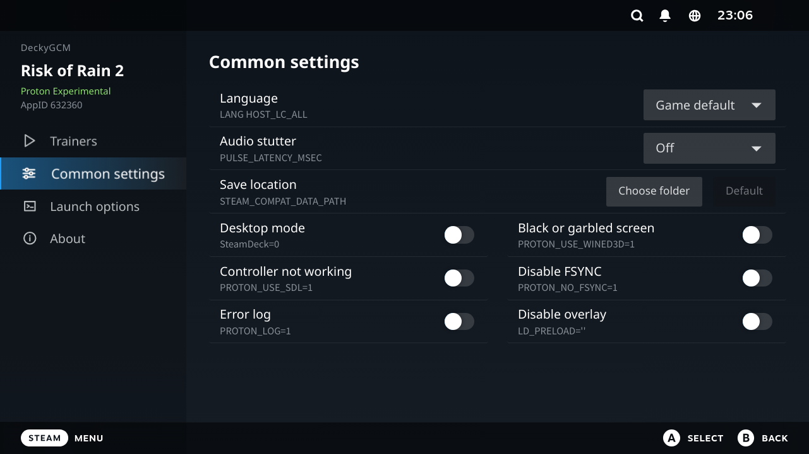
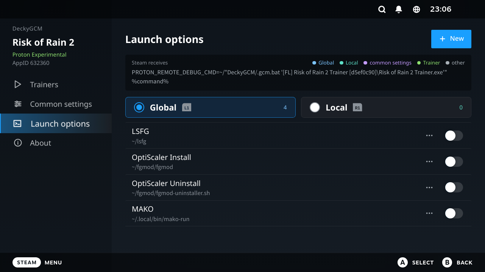

# DeckyGCM

English | [简体中文](README.zh-CN.md) | [繁體中文](README.zh-TW.md)



[](https://github.com/Qiming-Liu/Decky-Game-Cheats-Manager/releases/latest)
[](./LICENSE)

A [Decky Loader](https://github.com/SteamDeckHomebrew/decky-loader) plugin for managing
and downloading game trainers on Steam Deck, powered by
[Game Cheats Manager](https://github.com/dyang886/Game-Cheats-Manager) (GCM).

## Installation

Download **DeckyGCM.&lt;version&gt;.zip** from the [latest release](https://github.com/Qiming-Liu/Decky-Game-Cheats-Manager/releases/latest)
and install it through Decky Loader's developer settings. Use the plugin ZIP,
not GitHub's **Source code (zip)**.

## Using the plugin

The Quick Access panel shows how to open a game's page, links to **Advanced settings**
and **About**, and the downloads in progress. While a game runs with a Cheat Table, it
shows that table's switches instead (see [Cheat Tables](#cheat-tables)).

Trainers are stored in `~/DeckyGCM/` by default; the folder can be changed in
**Advanced settings**.

Each game (or non-Steam shortcut) gets one folder there, named after the game and its
app ID, with one folder per downloaded trainer inside:

```
~/DeckyGCM/
  Elden Ring (1245620)/
    Elden Ring Trainer [1a2b3c4d]/
    Elden Ring Table [5e6f7a8b]/
  Cheat Engine 7.5 [9c0d1e2f]/     shared by every game
```

Trainers that an earlier version put directly into the storage folder stay where they
are and keep working. A program or table you copy into a game's folder is listed for
that game.

Open **DeckyGCM** from a game's library context menu.

The page uses Decky's native left navigation, with five sections. Every change is
written to the game's Steam launch options (non-Steam shortcuts included) and takes
effect the next time the game starts.

1. **Trainers**: the bar at the top shows which trainer opens with the game; select a
   row to use that trainer instead, or turn it off. Downloads show their progress here
   and a finished download is selected automatically when none is selected yet.
   **Search** searches the catalog for this game (shown right away when the game
   has no trainer). **Local file** uses an `.exe`, `.bat`, `.ct` or `.cetrainer` where
   it is; nothing is copied, and a file that was moved is marked so it can be selected
   again.

   
   
2. **Common settings**: game language (`LANG`, `HOST_LC_ALL`), desktop behavior
   (`SteamDeck=0`), audio latency (`PULSE_LATENCY_MSEC`), and troubleshooting switches
   (`PROTON_USE_WINED3D`, `PROTON_NO_FSYNC`, `LD_PRELOAD=""` to turn off the Steam
   overlay, `PROTON_USE_SDL`, `PROTON_LOG`) plus the save data location
   (`STEAM_COMPAT_DATA_PATH`). Nothing is stored by the plugin: each switch shows what
   the launch options currently contain.

   
3. **Launch options**: a list shared by all games, each turned on or off per
   game. A new option is one variable, prefix command or game argument; its kind is
   detected as you type. Words in the launch options that nothing else recognizes are
   collected as one **User launch options** row. Defaults include presets for LSFG frame
   generation (`~/lsfg`), the OptiScaler patch (`~/fgmod/fgmod`, and its uninstaller),
   and [MAKO](https://github.com/eugeniosegala/MAKO) (`~/.local/bin/mako-run`). The tab
   also shows the exact launch options Steam receives.

   
4. **Advanced settings**: settings shared by every game: allow several trainers at once,
   a start delay, skipping the launcher check for Flatpak or AppImage shortcuts, Cheat
   Engine and its automatic attach, the storage folder and the trainer catalog.
5. **About**: version, update check, project links, the plugin log (export it for bug
   reports) and a reset for the game.

Environment variables are always written in alphabetical order, one per name. Prefix
commands and game arguments keep their order. Launch options using shell operators,
redirects or comments are left untouched and shown as read-only.

## Cheat Tables

A `.ct` or `.cetrainer` table opens through Cheat Engine, inside the game's Proton
environment. The plugin downloads Cheat Engine once, the first time a table needs it,
and every game shares that copy.

When the game starts, Cheat Engine attaches to it by itself, non-Steam shortcuts
included. Turn off **Auto attach** in **Advanced settings** to pick the process from the
Quick Access panel instead. While the game runs, the Quick Access panel lists the
table's entries: find an entry, switch scripts on and off, change or freeze values, or
turn everything off at once. Comments and credits show as plain text, and group headings
expand to the entries inside.

## Special thanks

Special thanks to [Game Cheats Manager (GCM)](https://github.com/dyang886/Game-Cheats-Manager)
and its author and contributors for their open-source work. GCM provides the core
trainer search and download functionality that makes DeckyGCM possible.

## License

GPL-3.0, same as upstream Game Cheats Manager.
