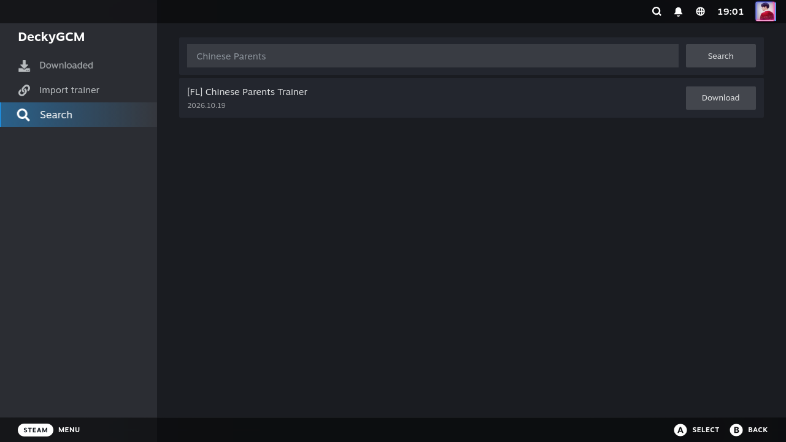

# DeckyGCM

A [Decky Loader](https://github.com/SteamDeckHomebrew/decky-loader) plugin for managing
and downloading game trainers on Steam Deck, powered by
[Game Cheats Manager](https://github.com/dyang886/Game-Cheats-Manager) (GCM).

## Using the plugin

The Quick Access panel contains only **Settings**: choose the trainer folder and
update the trainer catalog. The default storage path is `~/DeckyGCM/`.

Open **DeckyGCM** from a game's library context menu.

The page uses Decky's native left navigation, with three sections:

1. **Downloaded**: view progress and cancel downloads. Each installed trainer has a
   sidecar switch and a trash button. Enabling a trainer with multiple programs opens
   a program picker. Confirming deletion disables its sidecar before removing files.
2. **Import trainer**: select an `.exe` file to copy it into the library and record
   its association with this game. The copy appears under Downloaded; importing
   does not enable sidecar execution. Only the selected file is copied.
3. **Search**: opening this section automatically searches the prefilled game name
   when a local trainer catalog is available. Edit the name and press the inline
   **Search** button to search again. Results have an inline download button.

## Planned development

- [ ] **Cheat Table loading and controls**: support loading `.CT` files through
  Cheat Engine in the game's Proton environment and controlling table entries from
  Game Mode.

## Special thanks

Special thanks to [Game Cheats Manager (GCM)](https://github.com/dyang886/Game-Cheats-Manager)
and its author and contributors for their open-source work. GCM provides the core
trainer search and download functionality that makes DeckyGCM possible.

## License

GPL-3.0, same as upstream Game Cheats Manager.
