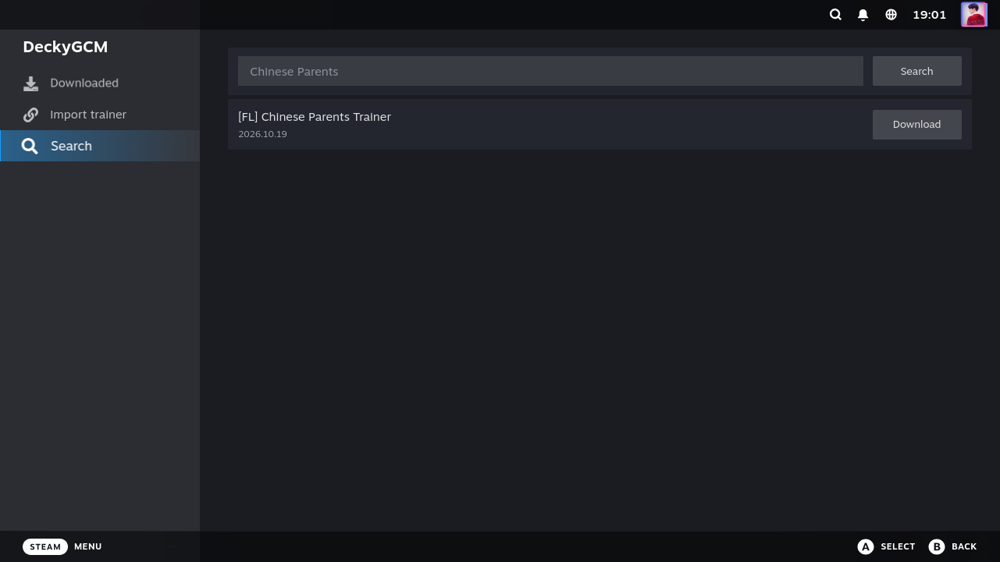

# DeckyGCM

A [Decky Loader](https://github.com/SteamDeckHomebrew/decky-loader) plugin for managing
and downloading game trainers on Steam Deck, powered by
[Game Cheats Manager](https://github.com/dyang886/Game-Cheats-Manager) (GCM).

## Using the plugin

The Quick Access panel contains only **Settings**: choose the trainer folder and
update the trainer catalog. The default storage path is `~/DeckyGCM/`.

Open **DeckyGCM** from a game's library context menu.

The page uses Decky's native left navigation, with three sections. Every change is
written to the game's Steam launch options (non-Steam shortcuts included) and takes
effect the next time the game starts.

1. **Trainers**: the bar at the top shows which trainer opens with the game; select a
   row to use that trainer instead, or turn it off. Downloads show their progress here
   and a finished download is selected automatically when none is selected yet.
   **Find trainers** searches the catalog for this game (shown right away when the game
   has no trainer). **Use a local file** uses an `.exe` or `.bat` where it is; nothing
   is copied, and a file that was moved is marked so it can be selected again.
2. **Common settings**: game language (`LANG`, `HOST_LC_ALL`), desktop behavior
   (`SteamDeck=0`), audio latency (`PULSE_LATENCY_MSEC`), and troubleshooting switches
   (`PROTON_USE_WINED3D`, `PROTON_NO_FSYNC`, `LD_PRELOAD=""` to turn off the Steam
   overlay, `PROTON_USE_SDL`, `PROTON_LOG`) plus the save data location
   (`STEAM_COMPAT_DATA_PATH`). Nothing is stored by the plugin: each switch shows what
   the launch options currently contain.
3. **Custom launch options**: a list shared by all games, each turned on or off per
   game. A new option is one variable, prefix command or game argument; its kind is
   detected as you type. Words in the launch options that nothing else recognizes are
   collected as a **User defined** option. Defaults include presets for LSFG frame
   generation (`~/lsfg`), the OptiScaler patch (`~/fgmod/fgmod`, and its uninstaller),
   and [MAKO](https://github.com/eugeniosegala/MAKO) (`~/.local/bin/mako-run`). The tab
   also shows the exact launch options Steam receives.

Environment variables are always written in alphabetical order, one per name. Prefix
commands and game arguments keep their order. Launch options using shell operators,
redirects or comments are left untouched and shown as read-only.

## Planned development

- [ ] **Cheat Table loading and controls**: support loading `.CT` files through
  Cheat Engine in the game's Proton environment and controlling table entries from
  Game Mode.

## Special thanks

Special thanks to [Game Cheats Manager (GCM)](https://github.com/dyang886/Game-Cheats-Manager)
and its author and contributors for their open-source work. GCM provides the core
trainer search and download functionality that makes DeckyGCM possible.

## License

GPL-3.0, same as upstream Game Cheats Manager.
