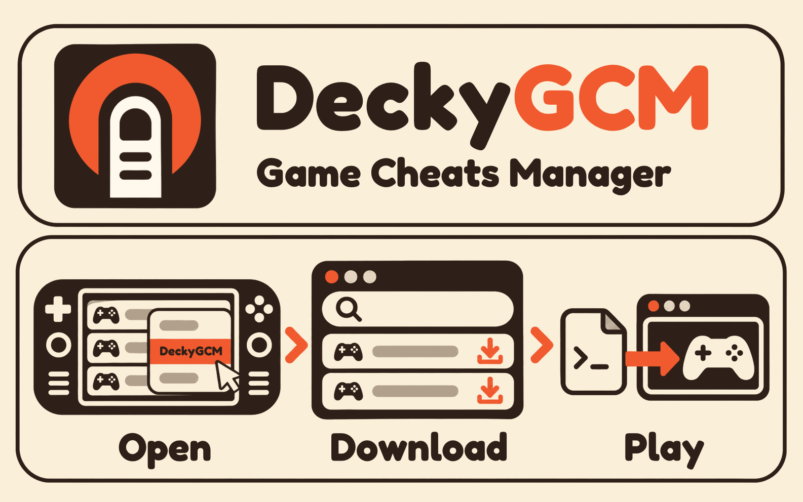
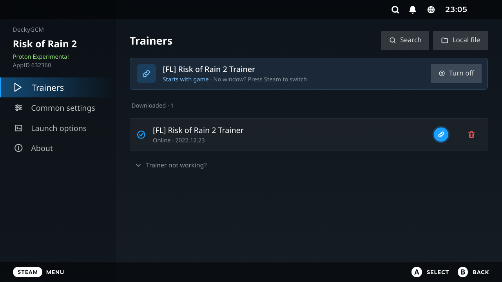
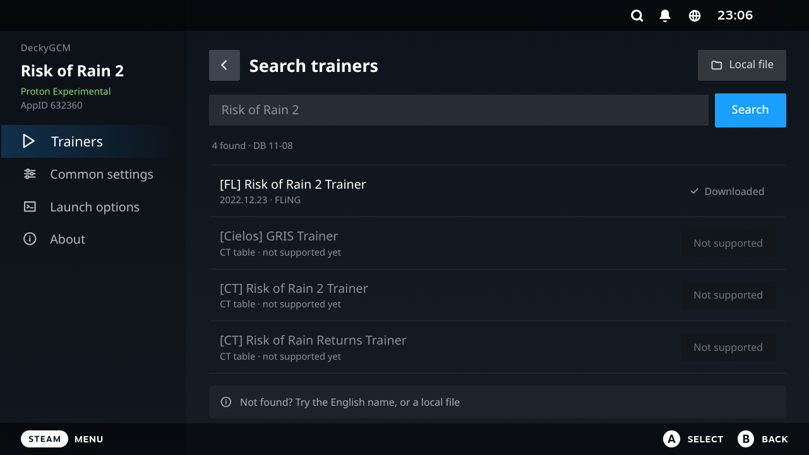
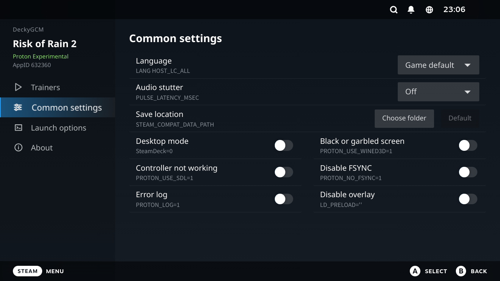
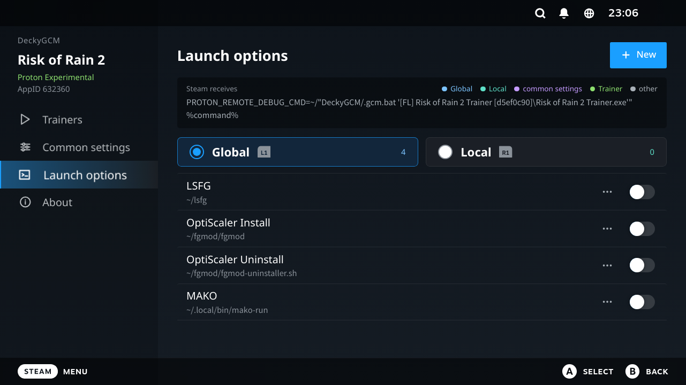

# DeckyGCM

[English](README.md) | 简体中文 | [繁體中文](README.zh-TW.md)



[](https://github.com/Qiming-Liu/Decky-Game-Cheats-Manager/releases/latest)
[](./LICENSE)

一款 [Decky Loader](https://github.com/SteamDeckHomebrew/decky-loader) 插件，在 Steam Deck 上管理和下载游戏修改器，核心功能来自
[Game Cheats Manager](https://github.com/dyang886/Game-Cheats-Manager)（GCM）。

## 安装

从[最新版本](https://github.com/Qiming-Liu/Decky-Game-Cheats-Manager/releases/latest)下载 **DeckyGCM.&lt;版本号&gt;.zip**，在 Decky Loader 的开发者设置里安装。请使用插件 ZIP，不要用 GitHub 的 **Source code (zip)**。

## 使用方法

快捷访问菜单里有打开游戏页面的指引、「高级设置」和「关于」的入口，以及正在进行的下载。游戏带着 Cheat Table 运行时，这里会改为显示这张表的开关（见 [Cheat Table](#cheat-table)）。

修改器默认存放在 `~/DeckyGCM/`，可以在「高级设置」里更换。

每个游戏（或非 Steam 快捷方式）在这里有一个文件夹，以游戏名和 App ID 命名，里面每个下载的修改器各占一个文件夹：

```
~/DeckyGCM/
  Elden Ring (1245620)/
    Elden Ring Trainer [1a2b3c4d]/
    Elden Ring Table [5e6f7a8b]/
  Cheat Engine 7.5 [9c0d1e2f]/     所有游戏共用
```

旧版本直接放在存放文件夹里的修改器原地保留，照常可用。复制到某个游戏文件夹里的程序或表，会显示在这个游戏下。

从游戏的库右键菜单打开 **DeckyGCM**。

页面使用 Decky 原生的左侧导航，共五个部分。所有改动都写入游戏的 Steam 启动选项（非 Steam 快捷方式也支持），下次启动游戏时生效。

1. **修改器**：顶部显示哪个修改器会随游戏启动；选中一行可改用那个修改器，也可以停用。下载进度显示在这里，没有选中修改器时，下载完成的会自动选中。
   **搜索** 会在目录里搜索当前游戏（游戏还没有修改器时直接显示搜索）。**本地文件** 直接使用原位置的 `.exe`、`.bat`、`.ct` 或 `.cetrainer`，不会复制；文件被移动后会有标记，方便重新选择。

   
   
2. **常用设置**：游戏语言（`LANG`、`HOST_LC_ALL`）、电脑模式（`SteamDeck=0`）、声音延迟（`PULSE_LATENCY_MSEC`），以及排查问题用的开关（`PROTON_USE_WINED3D`、`PROTON_NO_FSYNC`、关闭 Steam 覆盖层的 `LD_PRELOAD=""`、`PROTON_USE_SDL`、`PROTON_LOG`）和存档位置（`STEAM_COMPAT_DATA_PATH`）。插件不另存任何状态：每个开关都直接反映启动选项里的当前内容。

   
3. **启动项**：所有游戏共用一个列表，可按游戏单独开关。新建的启动项可以是一个环境变量、前置命令或游戏参数，输入时自动识别类型。启动选项里其他功能都不认识的内容会归为一行 **用户启动项**。默认包含 LSFG 补帧（`~/lsfg`）、OptiScaler 补丁（`~/fgmod/fgmod` 及其卸载程序）和 [MAKO](https://github.com/eugeniosegala/MAKO)（`~/.local/bin/mako-run`）的预设。这一页还会显示 Steam 实际收到的启动选项。

   
4. **高级设置**：所有游戏共用的设置：允许多开、开启延迟、对 Flatpak 或 AppImage 快捷方式跳过启动器检查、Cheat Engine 及其自动附加、存放路径和修改器目录。
5. **关于**：版本、更新检查、项目链接、插件日志（可导出用于反馈问题），以及重置本游戏的设置。

环境变量总是按字母顺序写入，每个名字只写一次。前置命令和游戏参数保持原有顺序。含 shell 运算符、重定向或注释的启动选项保持原样，只读显示。

## Cheat Table

`.ct` 或 `.cetrainer` 表通过 Cheat Engine 在游戏的 Proton 环境里打开。第一次需要时，插件会下载一次 Cheat Engine，所有游戏共用这一份。

游戏启动后，Cheat Engine 会自动附加到游戏，非 Steam 快捷方式也支持。在「高级设置」里关闭 **自动附加**，就可以改在快捷访问菜单里手动选择进程。游戏运行时，快捷访问菜单会列出表里的条目：可以找选项、开关脚本、修改或锁定数值，也可以一键全关。注释和署名只显示文字，分组标题可展开查看里面的条目。

## 特别感谢

特别感谢 [Game Cheats Manager (GCM)](https://github.com/dyang886/Game-Cheats-Manager)
及其作者和贡献者的开源工作。GCM 提供了修改器搜索和下载的核心功能，DeckyGCM 才得以实现。

## 许可证

GPL-3.0，与上游 Game Cheats Manager 相同。
