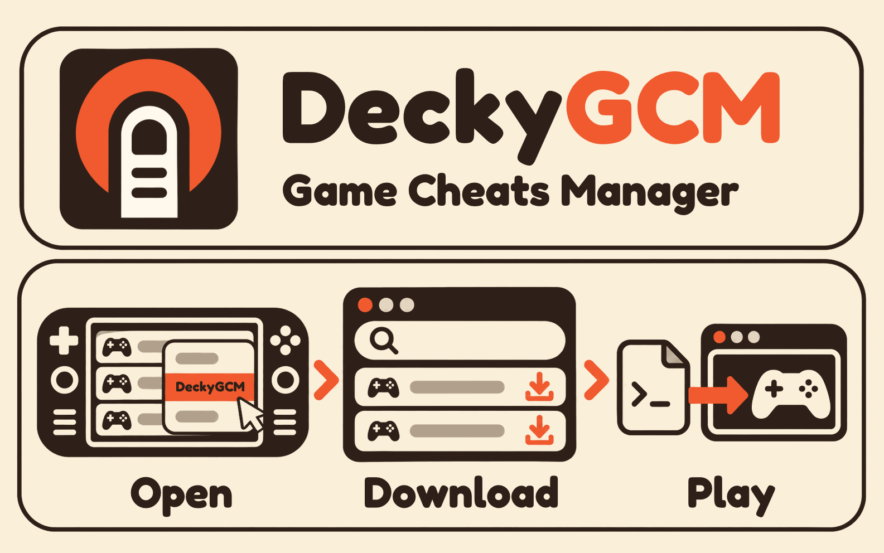
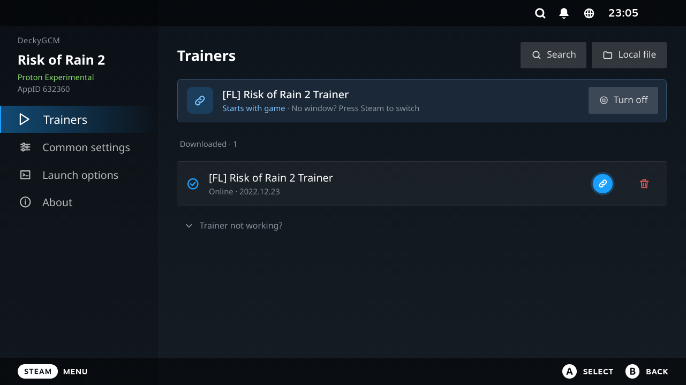
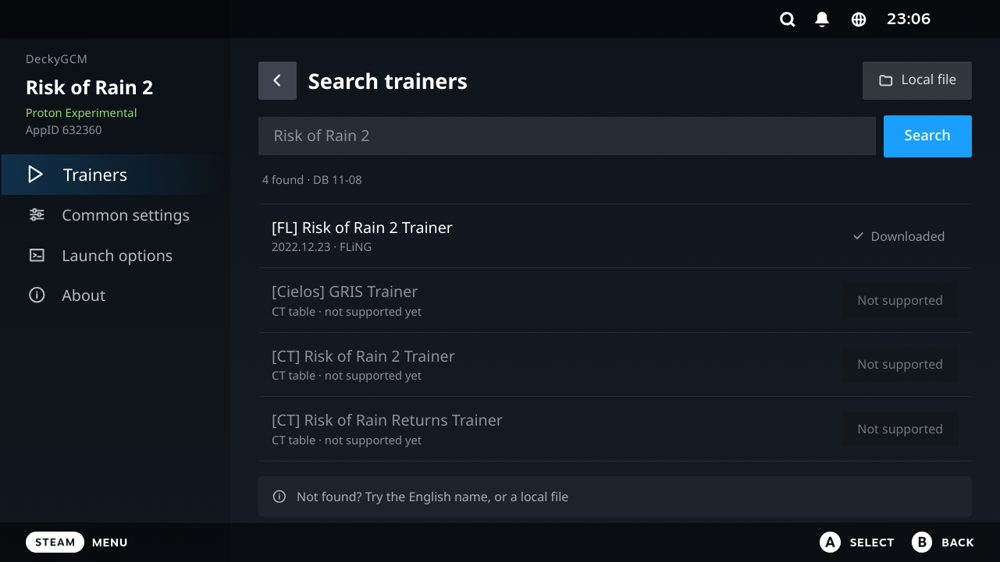
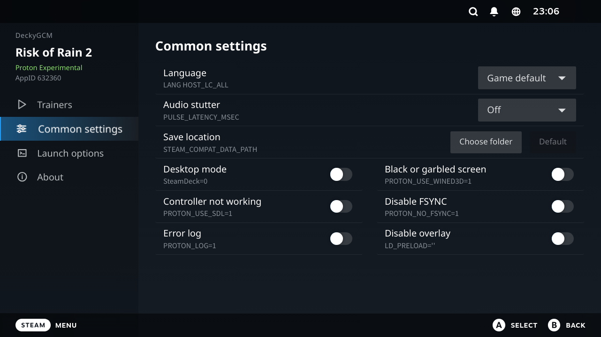
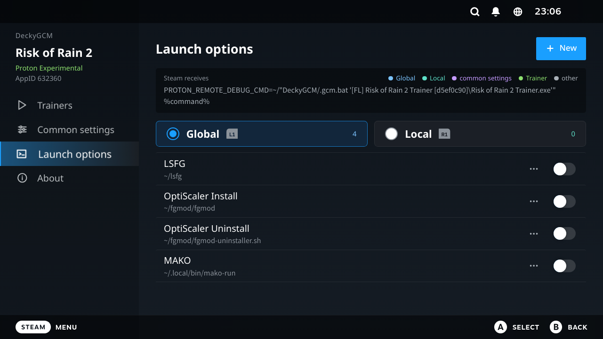

# DeckyGCM

[English](README.md) | [简体中文](README.zh-CN.md) | 繁體中文



[](https://github.com/Qiming-Liu/Decky-Game-Cheats-Manager/releases/latest)
[](./LICENSE)

一款 [Decky Loader](https://github.com/SteamDeckHomebrew/decky-loader) 外掛，在 Steam Deck 上管理和下載遊戲修改器，核心功能來自
[Game Cheats Manager](https://github.com/dyang886/Game-Cheats-Manager)（GCM）。

## 安裝

從[最新版本](https://github.com/Qiming-Liu/Decky-Game-Cheats-Manager/releases/latest)下載 **DeckyGCM.&lt;版本號&gt;.zip**，在 Decky Loader 的開發者設定裡安裝。請使用外掛 ZIP，不要用 GitHub 的 **Source code (zip)**。

## 使用方法

快速存取選單裡有開啟遊戲頁面的指引、「進階設定」和「關於」的入口，以及正在進行的下載。遊戲帶著 Cheat Table 執行時，這裡會改為顯示這張表的開關（見 [Cheat Table](#cheat-table)）。

修改器預設存放在 `~/DeckyGCM/`，可以在「進階設定」裡更換。

每個遊戲（或非 Steam 捷徑）在這裡有一個資料夾，以遊戲名稱和 App ID 命名，裡面每個下載的修改器各佔一個資料夾：

```
~/DeckyGCM/
  Elden Ring (1245620)/
    Elden Ring Trainer [1a2b3c4d]/
    Elden Ring Table [5e6f7a8b]/
  Cheat Engine 7.5 [9c0d1e2f]/     所有遊戲共用
```

舊版本直接放在存放資料夾裡的修改器原地保留，照常可用。複製到某個遊戲資料夾裡的程式或表，會顯示在這個遊戲下。

從遊戲的媒體庫右鍵選單開啟 **DeckyGCM**。

頁面使用 Decky 原生的左側導覽，共五個部分。所有變更都寫入遊戲的 Steam 啟動選項（非 Steam 捷徑也支援），下次啟動遊戲時生效。

1. **修改器**：頂部顯示哪個修改器會隨遊戲啟動；選取一列可改用那個修改器，也可以停用。下載進度顯示在這裡，沒有選取修改器時，下載完成的會自動選取。
   **搜尋** 會在目錄裡搜尋目前的遊戲（遊戲還沒有修改器時直接顯示搜尋）。**本機檔案** 直接使用原位置的 `.exe`、`.bat`、`.ct` 或 `.cetrainer`，不會複製；檔案被移動後會有標記，方便重新選擇。

   
   
2. **常用設定**：遊戲語言（`LANG`、`HOST_LC_ALL`）、電腦模式（`SteamDeck=0`）、聲音延遲（`PULSE_LATENCY_MSEC`），以及排查問題用的開關（`PROTON_USE_WINED3D`、`PROTON_NO_FSYNC`、關閉 Steam 覆蓋層的 `LD_PRELOAD=""`、`PROTON_USE_SDL`、`PROTON_LOG`）和存檔位置（`STEAM_COMPAT_DATA_PATH`）。外掛不另存任何狀態：每個開關都直接反映啟動選項裡的目前內容。

   
3. **啟動項**：所有遊戲共用一個清單，可依遊戲個別開關。新建的啟動項可以是一個環境變數、前置指令或遊戲參數，輸入時自動辨識類型。啟動選項裡其他功能都不認得的內容會歸為一列 **使用者啟動項**。預設包含 LSFG 補幀（`~/lsfg`）、OptiScaler 修補（`~/fgmod/fgmod` 及其解除安裝程式）和 [MAKO](https://github.com/eugeniosegala/MAKO)（`~/.local/bin/mako-run`）的預設項。這一頁還會顯示 Steam 實際收到的啟動選項。

   
4. **進階設定**：所有遊戲共用的設定：允許多開、開啟延遲、對 Flatpak 或 AppImage 捷徑跳過啟動器檢查、Cheat Engine 及其自動附加、存放路徑和修改器目錄。
5. **關於**：版本、更新檢查、專案連結、外掛日誌（可匯出用於回報問題），以及重設本遊戲的設定。

環境變數一律依字母順序寫入，每個名稱只寫一次。前置指令和遊戲參數保持原有順序。含 shell 運算子、重新導向或註解的啟動選項保持原樣，唯讀顯示。

## Cheat Table

`.ct` 或 `.cetrainer` 表透過 Cheat Engine 在遊戲的 Proton 環境裡開啟。第一次需要時，外掛會下載一次 Cheat Engine，所有遊戲共用這一份。

遊戲啟動後，Cheat Engine 會自動附加到遊戲，非 Steam 捷徑也支援。在「進階設定」裡關閉 **自動附加**，就可以改在快速存取選單裡手動選擇程序。遊戲執行時，快速存取選單會列出表裡的條目：可以找選項、開關腳本、修改或鎖定數值，也可以一鍵全關。註解和署名只顯示文字，分組標題可展開查看裡面的條目。

## 特別感謝

特別感謝 [Game Cheats Manager (GCM)](https://github.com/dyang886/Game-Cheats-Manager)
及其作者和貢獻者的開源工作。GCM 提供了修改器搜尋和下載的核心功能，DeckyGCM 才得以實現。

## 授權

GPL-3.0，與上游 Game Cheats Manager 相同。
